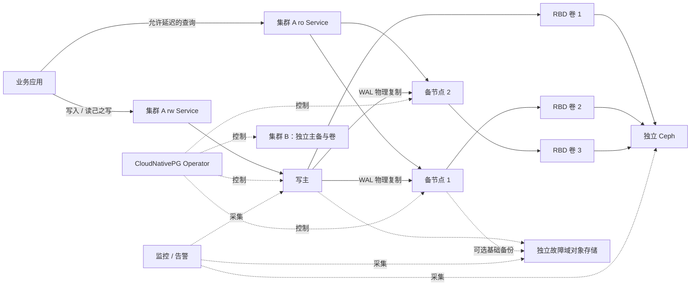

# PostgreSQL 多集群运维架构设计

| 项目 | 内容 |
| --- | --- |
| 设计日期 | 2026-10-28 |
| 适用范围 | Kubernetes 中多套独立的 PostgreSQL 单主多备集群 |
| 方案依据 | [已审核方案](../proposals/postgresql-kubernetes-ceph.md) |
| 状态 | 设计与实施基线；平台按最新稳定 Kubernetes/Ceph 持续升级；精确版本、容量和故障证据待交接 |
| 关联文档 | [部署](deployment.md)、[生产运维](operations.md)、[验收与故障演练](acceptance.md) |

## 1. 目标与原则

每套集群有一个写主、两个可读备节点；集群之间的数据、账号、存储卷和备份独立。业务、环境或故障影响范围需要隔离时，建立另一套集群，而不是让多个主节点同时写入同一份数据。各套集群仍共享 Kubernetes 控制面和 Ceph，不能把数据库层的独立等同于平台故障隔离。

核心目标如下：

1. 主备之间使用 PostgreSQL 物理流复制；默认选择至少一个同步备节点确认 WAL，副本不足时优先保护已确认事务。
2. 明确写主选举、旧主隔离和客户端重连的职责，任何无法验证的故障场景不承诺安全自动切换。
3. 每个数据库实例使用独立 RBD 卷；同步复制、Ceph 多副本和独立备份分别处理不同故障，不互相替代。
4. 通过基础备份和连续 WAL，在独立故障域保留可恢复副本，并定期恢复到隔离的新集群。
5. 单主故障后的写入恢复目标暂定 5 分钟；在明确的、已验证故障场景中，已确认同步事务的 RPO 目标为 0。它们是待验证设计目标，不能作为现有 SLA 或整站灾难恢复指标。

不涉及同一数据集多主同时写入、分布式分片、跨集群事务、跨地域双活或将现有实验集群直接认定为生产环境。

## 2. 总体结构与职责

| 组件 | 职责 | 故障或边界 |
| --- | --- | --- |
| Kubernetes API、调度器和网络 | 持久资源、调度、Service、Lease、策略和准入 | 控制面失去多数派时不能假定完成新选主、重调度或变更；已有连接能否继续取决于当时状态 |
| CloudNativePG Operator / 实例管理器 | 管理 PostgreSQL、实例生命周期、复制、服务、Lease 和切换 | 不替代节点电源隔离；Operator/API 故障影响协调和自愈，必须监控并演练 |
| PostgreSQL 主备 | WAL 复制、同步提交、恢复、应用 SQL | 一套集群只允许一个有效写主；只读备库可能滞后 |
| Ceph / Ceph-CSI | 提供 RBD 池、持久卷供应、挂载、扩容和回收 | 生命周期与 Kubernetes 分离；共享 Ceph 故障会同时影响多套数据库 |
| Barman Cloud Plugin / 对象存储 | PostgreSQL 基础备份、WAL 归档及恢复 | 插件控制面与实例 sidecar 均是依赖；目标对象存储及恢复密钥必须可从灾备环境访问 |
| 监控和外部探测 | 指标、告警、真实连接与事务探测 | 监控自身也要备份或具备独立观测路径；仅看 Pod Ready 不等于数据库可写 |

## 3. 部署拓扑与资源

### 3.1 多集群边界

每套数据库集群使用单独 Namespace、`Cluster` 资源、应用角色/Secret、备份身份与独立对象前缀。共享 Operator 只安装一次，平台方明确其监听范围和集群级 RBAC；数据库运维仅获授权操作自己的 Namespace。跨 Namespace、对象存储和 Ceph 的授权需要分别验证，Namespace 本身不是完整的安全隔离。

每套集群的三个实例至少分散到三个允许调度的节点，优先采用 `required` 反亲和。若要单节点故障后在该节点尚未恢复时重新凑齐三实例，需至少四个满足约束的节点和故障后的剩余资源。三个节点只能先以剩余两实例降级运行；硬反亲和可能令第三实例保持 Pending。多套集群共享节点时，应同时预算所有集群的正常运行、一个节点故障、备份、重建和恢复目标。

Kubernetes `kubernetes.io/hostname` 仅证明节点或 VM 分散。若要求抗单物理宿主机或存储柜故障，平台应交接 VM、物理主机、Datastore、网络和供电映射，使用已验证的故障域标签并实际验收。数据库计算节点与 Ceph OSD 即使角色不同，若位于同一物理宿主机，仍存在关联故障。

### 3.2 资源与容量

实例 CPU、内存、连接数、`shared_buffers`、`work_mem`、`max_connections`、WAL 峰值及备份 sidecar 的预算，以业务数据量、并发、性能目标和压测结果为准。示例资源值仅用于验证配置，不代表生产推荐值；尤其不能把 `work_mem` 当作实例级总内存上限。恢复过程需要额外的实例、卷、网络和对象读取额度。

三实例、Ceph 三副本时，若每实例实际存放 20 GiB 数据，粗略原始占用约 `3 × 20 × 3 = 180 GiB`。还需计入 WAL、数据库膨胀、快照、薄置备、元数据、各实例不一致的使用量、备份与重建空间。需分别核算 PVC 申请量、逻辑使用量、Ceph 原始使用量、池配额与故障恢复余量，不能把 PVC 配额当作已预留的物理空间。

## 4. 高可用与一致性

### 4.1 同步复制

基线使用 `method: any`、`number: 1`、`dataDurability: required`：一主两备时，满足同步提交语义的事务返回成功前，至少一个同步备节点确认 WAL。同步备节点都不可用时提交会等待，不自动降级成异步。备节点角色可以变化，不将某一固定实例永久视为同步节点。

`synchronous_commit=on` 等待远端 WAL 持久化确认，不等待所有只读副本回放；`remote_apply` 的等待范围不同，`remote_write` 也不等同于远端持久化。这里的持久化还依赖文件系统、RBD、Ceph 及底层设备正确实现同步写入。异步复制、`synchronous_commit=local/off/remote_write` 的事务不属于本设计的远端持久化保障范围。[PostgreSQL WAL 参数](https://www.postgresql.org/docs/18/runtime-config-wal.html)

持久化前提还包括 `fsync=on`、`full_page_writes=on` 和可用于复制与归档的 `wal_level`。UNLOGGED 表及序列的数据不会通过 WAL 正常复制，也不能由 WAL 在崩溃恢复时保护；临时表和数据库外部副作用同样不属于上述 RPO 范围。业务须盘点这些对象，不能把所有“提交成功”都视为已受主备保护。[PostgreSQL 非持久化设置](https://www.postgresql.org/docs/18/non-durability.html)

**默认配置不是强制策略。** PostgreSQL 普通会话可以自行修改 `synchronous_commit`，包括在单个事务中使用 `SET LOCAL`；仅检查服务器默认值、角色默认值或普通参数授权不能证明所有业务事务遵守。必须通过应用与客户端配置、代码审查、连接参数控制和业务验证约束；无法证明时不得对该业务宣称 RPO 为 0。

备库的查询可能早于最新提交。写后立即读取、事务内一致性和重要核对走主库；不能把只读 Service 或连接池视为自动 SQL 读写分离。只读 Service 无可用端点时返回不可用，不静默切主库。[CNPG Service 管理](https://cloudnative-pg.io/docs/1.30/service_management/)

### 4.2 选主、安全边界与降级

CloudNativePG 1.30 使用 Kubernetes Lease 协调实例晋升，并通过主实例隔离探测处理部分网络分区。Lease 只能协调选主，不能单独关闭仍在运行的旧主；隔离探测也依赖 kubelet、网络可达性和时序。示例设置 `smartShutdownTimeout: 0`，使探测触发的终止跳过 smart shutdown，减少旧连接继续写入的窗口，但不覆盖探测未触发、kubelet 卡死或旧主仍可被客户端直连等情况。[CNPG 自动切换](https://cloudnative-pg.io/docs/1.30/failover/)

即使有一个同步备节点，旧主和该备节点同时失联时，剩余备节点可能没有最后已确认的 WAL。示例启用 `failoverQuorum`，只在可构成足够仲裁且候选满足条件时自动晋升；CNPG 1.30 文档仍把该能力称为实验性。**这是候选实现，不是未经演练的零丢失承诺。** 生产启用必须核定选用版本的功能成熟度、实验性接受条件、异常组合以及可追溯的演练证据。

在示例的三实例 `ANY 1` 情况下，仲裁按 `R + W > N` 判断：两个备节点均可晋升时 `2 + 1 > 2`，允许继续选主；主和任意一个备节点同时不可用时仅有一个候选，`1 + 1 = 2` 不满足条件，自动晋升会等待，即使剩余节点实际上恰好已经追平。短期的可用性损失是这个一致性选择的一部分。还须检查实际对象：旧注解 `alpha.cnpg.io/failoverQuorum` 的优先级高于 spec，`false` 会覆盖并关闭保护；不能只看提交的清单。

强制验收[旧主与控制面分区但业务仍可连接旧主](acceptance.md#41-旧主与控制面分区的强制验收)，并行检查原主旧/新连接及候选写入；同步等待不作为 fencing 证据，必须证明原主失去写能力不晚于新主开放写入。Lease、Service 和 RWO 均不单独证明此条件。需要额外的物理或网络隔离时，由平台提供并验证对实际故障有效的节点/网络 fencing。本文不声称 CNPG 内置对任意节点的外部 STONITH，也不声称已经实现“等待人工批准后才切换”的门禁。默认自动切换可能早于人工介入；若无法满足安全要求，在生产流量接入前阻断投产、补齐可实现的隔离和切换机制，或重新选型，而不是依靠事后停 Operator 来保证安全。

| 故障场景 | 期望行为和限制 |
| --- | --- |
| 主进程/主 Pod 故障，其他组件正常 | Operator 检测后尝试选主；客户端连接中断并重连，连续已确认事务和真实恢复时间需核对 |
| 一个备节点故障 | 剩余备节点满足同步要求时可继续写；第三实例重建受节点、卷和反亲和约束 |
| 所有同步备节点不可用 | 同步提交等待；不自动改为 `preferred` 或异步，也不将写入暂停解释成数据库损坏 |
| 旧主与 API/其他实例网络分区 | 分别验证旧主进程、现有连接、Lease、隔离探测和外部 fencing；未能控制旧写入者时不能宣称安全 |
| 主和最新同步备节点同时不可用 | 较旧备节点不能仅凭 Ready 晋升；仲裁不足时应保持无主，恢复或人工决策需要评估数据丢失 |
| 主和任意一个备节点同时不可用 | 依上述三实例配置通常只剩一个候选，仲裁不足时不自动晋升；单主故障的 RTO 目标不覆盖此复合故障 |
| API、Operator 或共享 Ceph 故障 | 业务可用性、选主及调度取决于具体故障；不因备节点数量宣称平台级高可用 |

手动 `promote` 可以绕过仲裁检查，只有在旧主已可靠隔离、数据完整性和数据丢失风险得到业务确认后才可考虑；它不是常规故障自动处理步骤。禁止在未隔离旧主和未核对备份前强删 Pod、强制解绑卷或手工改数据库角色。

### 4.3 客户端与事务语义

`<cluster>-rw` 指向当前主，`<cluster>-ro` 指向备节点；`<cluster>-r` 可能包含主节点和备节点，不适合作为严格只读入口。Service 只控制新连接的路由，不强制数据库权限。备节点被提升时，原有会话可能保持连接并在提升后发起读写事务；若该会话使用有写权限的账号，即使最初通过 `ro` 接入也可能写入新主库。因此只读业务必须使用单独的低权限角色，逐项审查直接权限、角色成员关系、`PUBLIC` 授权以及可写入的 `SECURITY DEFINER` 函数；`default_transaction_read_only` 等会话默认值不能替代授权控制。[PostgreSQL 热备切换](https://www.postgresql.org/docs/18/hot-standby.html)

旧 TCP 连接不会透明迁移。客户端应配置有限连接超时、退避重连和幂等键；连接在提交响应前断开时，事务可能已提交，也可能回滚，必须按业务唯一键查询或对账，不能直接重复执行非幂等写入。

## 5. Ceph 与卷设计

数据库使用既有独立 Ceph 的 RBD 池，经 Ceph-CSI 按实例供应独占 PVC；不同 PostgreSQL 实例绝不共享一个 PGDATA 目录。优先沿用平台已验收的 StorageClass、CephX 最小权限和加密策略，不在数据库部署时重新创建 Ceph 集群、OSD 或同名 CSI。RBD 的 RWO/RWOP 是调度/挂载约束，不等价于已完成旧节点 fencing。[Kubernetes 持久卷](https://kubernetes.io/docs/concepts/storage/persistent-volumes/)

目标 StorageClass 应确认驱动和集群归属、`Retain` 回收策略、扩容能力、卷绑定模式和实际挂载行为；`Retain` 仅减少误删风险，不能阻止手工删除底层卷，也不等于备份。卷容量告警同时覆盖 PostgreSQL 文件系统、PVC、Ceph 池配额和物理空间。无业务数据迁移方案时禁止通过删除 PVC 或重建 OSD 修复故障。

数据与 WAL 默认共用实例卷；只有压测、容量和恢复流程证明有收益时才分卷。即使分为两个 RBD image，只要仍在同一个 Ceph/网络/物理存储故障域中，也不能宣称两个卷相互独立。调整卷、池或 CRUSH 前由存储负责人核定复制数、`min_size`、主机故障域、故障恢复剩余空间和前台延迟；不得为了恢复写入临时降低副本要求而忽略数据风险。

实际验证至少包括同步写入持久性、单 OSD/存储节点故障、Ceph 恢复负载、CSI 控制器与节点插件异常、节点隔离后的卷重挂、配额/磁盘满和真实存储故障域。故障恢复受慢 I/O、网络、CSI 卷映射和 Kubernetes 驱逐时间共同影响。

## 6. 备份、PITR 和灾难恢复

Barman Cloud Plugin 负责基础备份与持续 WAL 归档。建议每日一次基础备份，7 天或 30 天保留窗口由业务确定；恢复链必须包含基础备份、完整连续 WAL、时间线和插件所需元数据。`archive_timeout` 为关闭 WAL 段的间隔，并不包含归档失败、上传、异地复制和恢复耗时，不能单独作为灾备 RPO 的证明。[Barman 插件](https://cloudnative-pg.io/plugin-barman-cloud/docs/intro/)

首选直接写入物理上独立于 Ceph 的对象存储；若先写同一 Ceph 的 RGW，再复制到独立站点，则必须证明异地副本有完整可恢复链，并监控复制落后。跨域访问需要独立的身份、TLS、加密密钥、网络、镜像、Kubernetes/数据库恢复环境和操作材料。对象锁或不可变保留若与 Barman 删除策略冲突，需通过受支持的复制与保留设计解决，不能未经验证直接配置到同一写入前缀。

恢复默认新建隔离的 `Cluster` 和新 PVC，读取源备份时使用受限只读身份。恢复集群不能使用源归档前缀继续写 WAL；若需长期保留，先配置新的独立归档前缀及写凭据。PITR 要选择带时区的时间，确认选定基础备份先于目标且 WAL 覆盖目标；验证目标前数据存在、目标后数据不存在及业务约束，而不是只检查 Pod Ready。

灾备 RPO 按独立站点最新**可恢复**时间点与故障时刻差值测量；RTO 从事故发生至业务在隔离恢复目标完成核对并可正常服务。缺失任何 WAL、密钥、版本或对象权限时，备份任务成功也不能说明可以恢复。

## 7. 安全、网络与可观测性

业务身份、备份身份、监控身份和平台管理身份分离。数据卷和备份对象按平台能力加密；凭据与密钥存放于受控 Secret/外部密钥系统，不提交到公开仓库。应用连接要求 `sslmode=verify-full`、可信 CA 和匹配 Service DNS 的证书；通过 HBA、网络策略及实际负向测试拒绝明文和未授权来源。普通业务不使用超级用户，Operator 所需内置身份由其管理。

最小网络路径包括：应用到数据库 TCP 5432、同集群实例和初始化/恢复 Job 之间 TCP 5432/8000、Operator 到实例 TCP 5432/8000、监控到实例 TCP 9187、API server 到 Operator admission webhook TCP 9443、Operator/实例到 Kubernetes API、DNS、Barman 插件服务及对象存储 HTTPS。端口和实际流向以锁定版本与部署清单为准；CSI 节点到 Ceph 的流量由平台网络负责。默认拒绝策略必须覆盖允许和拒绝的双向实测，不能为了连通性放开整个 Namespace。[通信矩阵和示例](operations.md#2-网络与最小权限)、[CNPG 安全与端口](https://cloudnative-pg.io/docs/1.30/security/)

| 信号 | 初始处理建议；阈值需要压测和业务确认 |
| --- | --- |
| 主/备 Ready、Lease、选主状态、可写探测 | Ready 少于批准的期望数、逐实例指标缺失分别告警；独立业务事务证明提交，不能只看仍有一个同步备库 |
| 同步副本数量、复制/回放延迟、提交等待 | 同步副本不足立即告警；读取延迟和事务等待按业务阈值告警 |
| PVC 和 Ceph 池、WAL 和复制槽滞留 | 结合增长速度提前告警；复制槽和归档异常可能耗尽磁盘，禁止未经分析清理 WAL |
| 归档失败、连续可恢复时间点、基础备份失败 | 分别监控插件和对象存储；告警以独立故障域可恢复点为准，不能只看任务完成 |
| Operator、Barman 插件、API、证书到期 | 故障或续期异常告警；实际验证通知送达和恢复所需凭据 |

指标名称和标签随版本变化，部署时以实际暴露的指标和插件文档为准；不把被弃用的旧版备份指标当作唯一信号。慢查询、审计保留和通知路由由平台和业务共同核定。

## 8. 生命周期与交付边界

目标平台跟进最新稳定 Kubernetes 和 Ceph；每次按[升级检查](operations.md#11-每次平台升级的检查与回退)记录精确组合并复验隔离、恢复及告警，不把固定示例版本视为永久支持。小版本更新逐套滚动，先确认备份可恢复、同步状态、扩展和镜像摘要；大版本升级使用经确认的迁移路径及独立验证目标，不能只改镜像 major。变更后检查主备、同步等待、TLS、备份和客户端事务，再进入下一套集群。Operator、插件和 PostgreSQL 的升级必须检查版本矩阵与发布说明；资源对象、PVC 和对象存储生命周期分别管理。

生产交接必须留下：目标集群身份和责任人、版本与镜像摘要、故障域映射、资源/容量预算、恢复点与保留期、可复现的备份恢复和故障切换证据、密钥恢复路径、告警接收人及未覆盖故障清单。平台任何一项前置条件或强制验收未完成时，保持该环境未通过状态，不以示例配置或本文替代运行验收。
