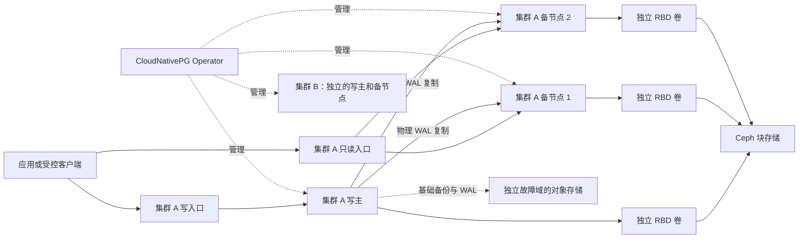

# PostgreSQL 多集群高可用方案

| 项目 | 建议 |
| --- | --- |
| 编制日期 | 2026-10-28 |
| 当前状态 | 方案方向已于 2026-10-28 审核通过；具体环境和生产验收仍待交接 |
| 范围 | 多套独立 PostgreSQL 集群、Kubernetes、Ceph、备份恢复、监控和安全 |
| 一套集群 | 一个写主、两个只读备节点，支持各集群独立扩展 |

## 1. 目标与边界

建议在 Kubernetes 中运行多套相互独立的 PostgreSQL 集群，每套集群通过物理流复制维护一个写主和至少两个备节点。不同集群可分别服务不同业务或环境，拥有独立的数据库身份、资源预算、存储卷、连接入口和备份策略。

这里的“多主从”指多套单主多从集群：每套集群同一时刻只允许一个有效写主。不同集群的主节点可以同时写入各自的数据；同一份数据的多主同时写入、自动跨集群分片或跨集群事务不属于本期目标。

本方案默认平台已有 Kubernetes、网络、Ceph 和可信证书等基础设施；实际接入必须先核对对应平台的交付状态与版本，不能把目标规划当作已完成验收。本文仅用于讨论，不包含部署步骤、可执行清单或实际运行结论。

## 2. 选型建议

| 领域 | 推荐 | 原因与边界 |
| --- | --- | --- |
| 数据库 | 受支持的 PostgreSQL 18 系列作为新集群候选 | 具体补丁版本、扩展兼容性及镜像在实施前冻结；现有集群不能直接换大版本镜像 |
| 集群管理 | CloudNativePG Operator | 原生管理实例、复制、服务和故障切换，适合 Kubernetes 中多套集群；实际支持矩阵和运维隔离需逐项核对 |
| 持久化 | 独立 Ceph + Ceph-CSI + RBD PVC | 每个 PostgreSQL 实例使用各自的块卷；Ceph 提供块存储，不替代数据库复制或备份 |
| 数据保护 | Barman Cloud Plugin + 对象存储 | PostgreSQL 物理基础备份与持续 WAL 归档，用于时间点恢复；与目标 S3 实现的兼容性需实测 |
| 连接 | CNPG 的写入口和只读入口；连接池按需增加 PgBouncer | 应用显式区分读写，连接池不承担自动 SQL 读写拆分 |
| 监控 | Prometheus / Alertmanager 及平台既有指标体系 | 数据库、备份、Kubernetes、Ceph、客户端和告警链路共同观测 |

另一可选路径是 PostgreSQL + Patroni，适合同时覆盖虚拟机/裸机和 Kubernetes，灵活性更高，但需要单独落实部署、集群管理、入口及备份集成。Patroni 可以使用 Kubernetes API 作为协调存储，并非必然需要另建 etcd。当前工作负载以 Kubernetes 为主，优先评估 CloudNativePG；如果严格的数据安全要求无法在可接受的组件成熟度下满足，再比较 Patroni 等替代方案。

采用 Operator 已是本场景的协调与生命周期管理机制，不另造一套主从选举或控制器。实际版本须同时匹配 Kubernetes、PostgreSQL、Ceph-CSI、备份插件和扩展，并在实施前锁定镜像摘要及支持状态。

## 3. 逻辑方案

- 每套集群建立独立的数据库实例、PVC、Service、凭据、备份与监控标识；同一 Kubernetes 和 Ceph 仍是多套集群的共享故障域，需要统一做平台级容量和故障演练。
- 写入及要求读己之写的查询走写入口；只读入口的新连接指向可用备节点，备节点不存在时应报告不可用，不能默认为可写入口。备库可能有复制延迟，应用按一致性要求选择入口；备节点提升后旧连接可能继续存在，只读业务还须使用单独的低权限账号，不能仅依赖 Service 路由。
- Service 地址切换不能保证现有连接不中断。客户端应实现重连、超时及幂等策略；连接在提交响应前断开时，事务结果可能未知，不能无条件重试。
- 外部访问、数据库连接池、多集群隔离等级及具体网络策略按实际客户端和并发量确定，不默认开放公网。

## 4. 复制、切换与数据安全

**建议先以同步复制作为基线**：一主两备，事务提交至少等待其中一个备节点确认 WAL 持久化，且不在同步副本不足时自动放宽要求。必须约束或识别会话级异步提交等例外。只读备节点可以承担查询，但读取并不自动满足读己之写。

这是一项一致性与可用性的取舍：同步备节点不可用时，写事务可能等待；异步复制可降低等待，但主库故障后存在已提交数据丢失窗口。同步复制也不意味着任意故障都零丢失：若写主和已确认的同步备节点同时不可用，剩余备节点可能较旧；默认自动切换并不能单独证明不会选中较旧的副本。

候选决策如下：

| 路线 | 说明 | 主要代价与待验证事项 |
| --- | --- | --- |
| A：至少一个同步备节点 + 切换仲裁 | 优先研究；仅在确认候选副本包含所需已提交数据时切换 | CloudNativePG 1.30 文档仍将 failover quorum 描述为实验性功能；须核实最终版本状态、故障覆盖和生产可接受性，不能仅凭方案承诺安全 |
| B：两个备节点都确认同步提交 | 两个备节点均确认后返回事务结果 | 任一备节点不可用即可能阻塞写入；仍需处理旧主隔离和复合故障 |
| C：异步复制，优先恢复写入 | 保留自动切换速度和较低提交延迟 | 接受可能丢失已确认事务，并按实测设置可接受的 RPO |

旧主隔离是独立前提。需要验证 Kubernetes Lease、实例隔离探测、停机时序与实际网络分区行为；必要时结合受控的节点/网络隔离机制。CloudNativePG 默认自动切换不会因为这里提出的要求而自动等待人工确认。若无法证明旧主已停止写入或候选副本满足数据安全要求，不能宣称该场景可安全自动切换；需先验证能否落实切换门禁或选择其他实现，完成演练后才能上线。仅靠 Service 摘除或 PVC 访问模式不能证明旧主已被隔离。

对于目标优先保护已确认事务的业务，建议以特定已验证故障场景中 **RPO 目标为 0** 作为设计目标，前提是同步提交、正确候选副本和旧主隔离均成立；不覆盖所有复合故障和整站灾难。单主节点故障后的写服务恢复时间暂建议以 **5 分钟以内**作为待验证目标，从故障发生计至客户端重新成功提交，不能当作现有 SLA。故障中断、事务结果不确定和延迟增加均需纳入业务预期。

## 5. Kubernetes 与 Ceph 的资源边界

- 一套三实例集群至少需要三个可调度的独立节点故障域，采用明确的实例反亲和或拓扑约束；还要预留 Operator、监控、连接池和备份的资源。节点分散不等于底层物理主机、磁盘或供电分散。
- 只有三个合适节点时，失去一个节点后集群可在剩余两个实例上降级运行，但硬反亲和通常无法在剩余两节点立即重建第三实例。要在单节点故障后仍恢复三实例，需要至少第四个合适的可调度故障域，并预留足够 CPU、内存和卷挂载能力。多套集群要按汇总峰值与单节点故障后的容量一起核算。
- 每个实例独占自己的 RBD 卷，不让多个 PostgreSQL 实例共享同一个数据目录。读写访问模式和卷附着限制不能替代隔离旧写入者；`Retain`、扩容、快照及卷回收按平台策略和实际 CSI 能力验收。
- PostgreSQL 三份完整数据与 Ceph 三副本分别提供不同层面的保护，同时会放大空间和写入需求。粗略示例：三实例各使用 20 GiB 数据，Ceph 三副本约消耗 180 GiB 原始空间；实际还要计算 WAL、卷元数据、快照、压缩、临时空间、恢复余量和后端配额。
- 数据和 WAL 是否分卷根据业务 I/O 与现有平台压测决定；同一 Ceph 集群上的两个卷不自动形成独立故障域或独立性能资源。需验证 Ceph 单 OSD/节点故障、重建期间 I/O、网络拥塞、CSI 卷重挂、磁盘满和恢复所需剩余容量。
- Ceph/RGW 如与数据库卷共用同一存储集群，其副本和对象备份仍有共同故障域；不能把同域副本称为独立灾备。

## 6. 备份与恢复

建议以 PostgreSQL 基础备份加连续 WAL 归档作为 PITR 主路径，采用 Barman Cloud Plugin；初始讨论值为每日一次基础备份，按业务选择 7 天或 30 天恢复窗口，并根据写入量核算 WAL、网络和保留空间。保留周期、频率和告警阈值最终由业务决定。

首选备份写入独立于数据库 Ceph 故障域的受控对象存储。如果本地 RGW 用作暂存，还需要复制完整基础备份、连续 WAL 和所需元数据到独立故障域，并验证副本可恢复；仅有复制任务成功或对象存在不代表 PITR 可用。物理故障域、凭据、证书、加密密钥和恢复所需镜像都要在生产集群不可用时可取得。

至少覆盖定期在隔离的新集群中进行全量恢复和指定时间点恢复、校验目标前后数据，以及在单独故障域读取备份。灾难恢复的 RPO 取决于可恢复备份与 WAL 归档/复制的实际进度，不能沿用同城同步主从的 RPO 目标；恢复用时也须按数据量和可用带宽测量。逻辑导出可用于迁移或对象级恢复，不能代替上述物理备份链。

## 7. 安全、监控和生命周期

- 每个集群按需配置受限应用角色、运维角色及备份身份；Kubernetes RBAC、Secret、CephX、对象存储权限和网络访问分别最小化。凭据、真实地址和业务数据不进入公开仓库。
- 访问链路使用 TLS，验证服务端身份；复制、备份和监控使用各自所需的受限身份。证书续期和恢复入口要可检查、可告警。
- 监控主备状态、复制与回放延迟、提交等待、连接和慢查询、磁盘与 WAL 水位、归档及备份失败、恢复点时间、PVC 和 Ceph 延迟/容量、Operator 与 Kubernetes 控制面健康。告警需验证实际送达及值班响应路径。
- 保留 PostgreSQL 小版本升级、主版本迁移、扩展兼容、计划内切换及回退的审查和演练；主版本升级不是直接更换容器镜像。多集群按批次操作，避免一次升级同时影响所有业务。

## 8. 审核后的验证方向

| 验证项 | 最少需要看到的结果 |
| --- | --- |
| 正常业务 | 多套集群入口、授权和数据互相隔离；写入、只读及复制延迟符合各自目标 |
| 单节点 / 主实例故障 | 持续记录已确认事务；旧主被隔离、候选副本安全、客户端重新提交并测量恢复时间 |
| 网络分区与复合故障 | 覆盖旧主仍可接收客户端流量、同步备节点不可达、Kubernetes API 不可达；无法确认安全时不能宣称自动切换可靠 |
| 存储故障 | 单 OSD、存储节点、CSI 重挂、容量和重建压力下，记录数据正确性、业务中断及 Ceph 恢复 |
| 备份与灾难恢复 | 持续归档、备份保留、隔离恢复和时间点前后数据校验；独立故障域中重建并测量实际 RPO/RTO |
| 运维和安全 | 证书轮换、最小权限、告警送达、计划切换、版本升级及多集群批次操作 |

以上均是未来验收项目，未因本方案而执行或通过。故障注入和实际环境变更需在选定环境及维护边界后安排。

## 9. 落地时需要交接的事项

1. 在目标版本和故障演练中核实 CloudNativePG + PostgreSQL + Ceph RBD 的适用性；必要时重新评估 Patroni。
2. 确定业务对已确认事务安全和持续写入的取舍，并核定实验性 failover quorum 的实际可用性与生产接受条件。
3. 每套集群预估数据量、日增量、并发和目标集群数量是多少？实际平台能否提供三到四个独立可调度故障域及故障后的资源余量？
4. 备份是否有独立故障域对象存储？请确定恢复窗口、灾难恢复 RPO/RTO 和定期恢复演练频率。
5. 主要客户端是否仅在 Kubernetes 内，是否需要受控的集群外 TCP 入口和连接池？

方案对应的[运维架构设计](../docs/architecture.md)和[部署与验收文档](../docs/deployment.md)已编写。目标 Kubernetes/Ceph 按最新稳定版本持续升级；实际部署和每次升级均须完成精确版本记录、兼容矩阵、容量和故障复验，见[当前运维手册](../docs/operations.md#1-版本与交接基线)。本方案保留审核时的选型背景，不代表旧参考版本已兼容未来平台。

## 参考资料

- [PostgreSQL 流复制和同步复制](https://www.postgresql.org/docs/current/warm-standby.html)
- [PostgreSQL 版本支持策略](https://www.postgresql.org/support/versioning/)
- [CloudNativePG 自动故障切换与切换仲裁](https://cloudnative-pg.io/docs/1.30/failover/)
- [CloudNativePG 读写服务](https://cloudnative-pg.io/docs/1.26/service_management/)
- [CloudNativePG 支持的备份方式](https://cloudnative-pg.io/docs/current/backup/)
- [Barman Cloud Plugin](https://cloudnative-pg.io/plugin-barman-cloud/docs/intro/)
- [Ceph RBD 与 Kubernetes](https://docs.ceph.com/en/latest/rbd/rbd-kubernetes/)
- [Kubernetes 持久卷访问模式](https://kubernetes.io/docs/concepts/storage/persistent-volumes/)
- [Patroni 在 Kubernetes 中的协调方式](https://patroni.readthedocs.io/en/latest/kubernetes.html)
